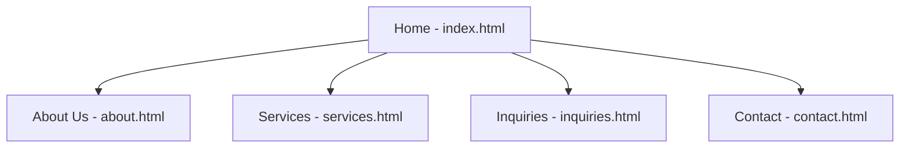

# FlowFix Plumbing Services Website

## Student Information
- **Name:** Mpumelelo Baatjie
- **Student Number:** ST10517925
- **Module:** WEDE5020 - Web Development (Introduction)


## Project Overview
FlowFix Plumbing Services is a fictional small business website built for the
WEDE5020 Portfolio of Evidence. The project is developed in three parts:
- **Part 1:** Planning and building the HTML foundation
- **Part 2:** CSS styling and responsive design
- **Part 3 (current):** JavaScript functionality, SEO, form validation and
  deployment

## Website Goals and Objectives
- Make it easy for customers to request a plumber and describe their problem
  online instead of relying only on phone calls.
- Build trust and credibility with potential customers, since most shoppers
  research a business online before making a decision (Wix.com 2026).
- Success will be measured by enquiry form submissions, emergency callout
  requests, and growth in monthly website visitors.

## Key Features and Functionality
- Homepage with a visible emergency contact number, an emergency tips pop-up
  (modal) and dynamically loaded plumbing tips
- About Us page with company history, values, team, and a photo gallery with
  a lightbox
- Services page listing plumbing services and starting prices, with live
  search, filter and sort, and an FAQ accordion
- Inquiries page with a validated quote form that returns a cost estimate and
  availability
- Contact page with two interactive maps, a "find my nearest branch" feature,
  and a validated contact form that compiles an email

## Timeline and Milestones
- Week 1-2: Research, planning, and content gathering
- Week 3-4: HTML structure (Part 1)
- Week 5-6: CSS styling and responsive design (Part 2)
- Week 7-8: JavaScript functionality, SEO, forms and deployment (Part 3 -
  current stage)

## Part 1 Details
Part 1 includes:
- Website Project Proposal (submitted separately)
- Research and content gathering
- Sitemap (see below)
- File and folder structure
- Initial HTML files for all 5 pages, with semantic structure and content

## Part 2 Details
Part 2 added:
- An external stylesheet (`css_assets/style.css`), linked from all 5 pages
- A base style (colours, fonts, spacing) matching the blues-and-greys scheme
  from the Website Project Proposal
- Typography styling for headings and body text
- A flexbox layout for the header/navigation, and for the service and
  location cards on the Services and Contact pages
- Visual styling: buttons, cards, form fields, hover and focus states
- Responsive design with two breakpoints (tablet: 768px, mobile: 480px),
  using relative units (rem, %) and a responsive hero image (`srcset`)

## Part 3 Details
Part 3 starts by working through the Part 2 feedback, then adds JavaScript
functionality, SEO, form validation and deployment. Every change is recorded
in the [Changelog](#changelog).

### Feedback from Part 2
| Rubric criterion | Part 2 result | What was done in Part 3 |
|------------------|---------------|--------------------------|
| Knowledge: Feedback for Part 1 | 7/10 - "Changelog is detailed but could be improved" | The changelog was rewritten (see below): every entry now has a date, the files affected, what changed and why, and entries are grouped by part. The placeholder `[Add date]` entries and the screenshots/folder notes were checked against the real project files. |
| All CSS (desktop, responsive) criteria | Full marks | Kept as they were. The Part 3 CSS was **added** in a new section 11 at the bottom of `style.css`; only the heading rules changed (see SEO below). |
| GitHub (commits, README, changelog, references) | Full marks | Kept at the same standard, and updated for Part 3. |

Other quality fixes made while working through the feedback:
- The README mentioned a `testing-screenshots` folder that was missing from
  the project; the folder now exists and contains new screenshots of all 5
  pages.
- The `js_assets` and `private` folders listed in the folder structure now
  exist.
- A spelling mistake ("hygenic") and a stray space on the About page were fixed.
- The unused 1 MB logo files are not loaded by any page (they stay in
  `_images` for the proposal) so they do not affect page speed.

### JavaScript Enhancements
| Requirement | Where | How it works |
|-------------|-------|--------------|
| Accordion (jQuery) | `services.html` FAQ, `js_assets/ui-jquery.js` | Each question is a button. jQuery's `slideToggle()` slides the answer open or closed, one at a time. `aria-expanded` keeps screen readers informed. |
| Modal (jQuery) | `index.html` "Plumbing emergency?" button, `ui-jquery.js` | The pop-up opens with a CSS fade, closes with the X button, Escape key, or a click outside it, and keeps keyboard focus inside while open. |
| Interactive maps (Leaflet) | `contact.html`, `js_assets/map.js` | One Leaflet map per branch with OpenStreetMap tiles and a marker popup. A "Find my nearest branch" button uses the Geolocation API and the haversine formula to highlight the closer branch. |
| Animations and transitions | `style.css` section 11.2, `main.js`, `tips.js` | CSS transitions on buttons, cards, modal and lightbox; sections fade in on scroll using `IntersectionObserver`; animations switch off for visitors who prefer reduced motion. |
| Advanced DOM manipulation | `main.js`, `tips.js`, `services.js`, `gallery.js`, `forms.js` | Elements are created with `createElement` (back-to-top button, tips, lightbox, results panels), collected in `DocumentFragment`s, re-ordered, shown/hidden and updated with ARIA attributes. User text is always added with `textContent`. |
| Gallery with lightbox | `about.html` "Our Work", `js_assets/gallery.js` | Thumbnails are normal links to the full photos (so they work without JavaScript). The script opens them in a lightbox with previous / next / close buttons and arrow-key and Escape support. |
| Dynamic content | `index.html` "Plumbing Tips", `js_assets/tips.js` | Tips are stored as a JavaScript array and built into cards on the page; "Load more tips" adds three at a time. |
| Search, filter and sort | `services.html`, `js_assets/services.js` | A search box, a type filter and a sort menu (price low-high, high-low, name A-Z) work on the existing service cards using their `data-category` and `data-price` attributes. A live message shows how many services match. |

### Search Engine Optimization (SEO)
**Keyword research.** The target phrases were chosen by combining each service
from the Website Project Proposal with the two areas the business serves, the
way a customer would type a search (service + town). Search volumes have not
been measured; the next step for a real business would be to confirm them in
Google Keyword Planner or Google Trends.

| Page | Primary keyword | Supporting keywords |
|------|-----------------|---------------------|
| Home | plumber Pretoria | plumber Centurion, emergency plumber, geyser installation |
| About Us | Pretoria plumbers | plumbing company since 2019 |
| Services | plumbing services Pretoria | leak repairs, geyser installation and repair, drain unblocking |
| Inquiries | plumbing quote Pretoria | free plumbing quote, request a plumber |
| Contact | plumber Centurion | contact plumber Pretoria, plumber near me |

**On-page SEO**
- **Title tags and meta descriptions:** every page has a unique `<title>`
  and `<meta name="description">` (under about 160 characters) containing its
  keyword and the service area (Google Search Central n.d.a; n.d.c).
- **Header tags:** each page now has exactly one `<h1>` describing the page.
  In Part 2 the business name in the header was the `<h1>` on every page. It is
  now a `<p class="site-title">`, section headings are `<h2>`, and the service
  and location card headings changed from `<h3>` to `<h2>` so heading levels
  are not skipped (Google Search Central n.d.e). The CSS was updated so the
  pages look the same as before.
- **Image optimisation:** images were renamed with descriptive, hyphenated
  names (for example `leaking-pipe-repair.jpg`), every image has descriptive
  alt text, `width` and `height` attributes, and images below the first screen
  use `loading="lazy"` (Google Search Central n.d.b; web.dev n.d.).
- **URL structure:** page addresses are short, lowercase and descriptive
  (`services.html`, `contact.html`) (Google Search Central n.d.f).
- **Internal linking:** body text now links between related pages (for
  example Home to Services and About to Contact), and a footer navigation was
  added to every page.
- **Mobile-friendliness:** the viewport tag and Part 2 responsive layout were
  kept, and the new components (filter bar, maps, lightbox, forms, modal) have
  tablet and mobile rules.

**Off-page SEO** (planned strategy - this is a coursework site, so no real
backlinks have been built)
- **Backlinks:** register the business on Google Business Profile and South
  African business directories, and ask suppliers and community pages to link
  to the website.
- **Social media:** Facebook and Instagram links were added to the footer
  (they currently point to the platforms' home pages until real business pages
  exist), and Open Graph tags were added so shared links show a title and
  description.
- **Local SEO:** JSON-LD structured data (`Plumber` type) with the address,
  phone, opening hours and areas served was added to the home page, and both
  branches (with map coordinates) to the contact page (Google Search Central
  n.d.d). Addresses use the semantic `<address>` element and the same name,
  address and phone details are used everywhere.

**Additional requests**
- **Page speed:** scripts use `defer`; jQuery loads only on the two pages
  that need it and Leaflet only on the contact page; images have fixed sizes
  and lazy loading; the heavy Google Maps iframes were replaced by Leaflet.
- **Security:** a Content-Security-Policy meta tag limits where scripts,
  styles, images and data can come from (MDN Web Docs n.d.b); jQuery and
  Leaflet are self-hosted so no third-party script is loaded; links that open
  a new tab use `rel="noopener noreferrer"`; user text is inserted with
  `textContent` (OWASP n.d.); forms have a honeypot spam field; a referrer
  policy is set. Note: GitHub Pages does not let a site set HTTP headers, so
  the meta tag is used instead.

### Form Functionality and Validation
Both forms use HTML5 validation attributes (`required`, `type`, `minlength`,
`maxlength`, `pattern`, `min`) so they still work without JavaScript. When
`js_assets/forms.js` loads it switches off the browser's default pop-ups and
shows clearer messages under each field, using the Constraint Validation API
(MDN Web Docs n.d.a). Fields are checked when the visitor leaves them and
again while typing once they have been marked wrong.

| Form | Page | What it does |
|------|------|--------------|
| Enquiry form | `inquiries.html` | Collects name, email, phone, service, area (only for per-square-meter services), branch, urgency, preferred date (not needed for emergencies) and the problem. After validation the data is sent with **AJAX** (`fetch`) to the form's `action` address (JSONPlaceholder test API, JSONPlaceholder n.d.), then the page shows a **cost estimate** from the starting prices and the **availability** (opening hours, Sunday check, emergency numbers). If the server cannot be reached, it clearly says the enquiry was not sent. |
| Contact form | `contact.html` | Collects name, email, optional phone, type of message and the message. After validation the answers are compiled into an email addressed to the recipient set in `RECIPIENT` at the top of `forms.js` (flowfix@gmail.com). A preview is shown and the visitor presses "Open in my email app" (a `mailto:` link, Duerst, Masinter and Zawinski 2010) to send it. |

Validation rules: name (letters, 2-60 characters), email format, South African
phone number (`012 345 6789` or `+27 12 345 6789`), area (whole number 1-500),
date (today or later), problem and message (10+ characters, with a live
character counter), and required fields.

The enquiry form posts to a test address that does not store data. To collect
real enquiries, change `ENQUIRY_ENDPOINT` in `forms.js` to a form service
address (for example Formspree or Netlify Forms).

### Responsive Testing
Screenshots are in `_images/testing-screenshots/`, rendered at three widths.

| Page | Desktop (1200px) | Tablet (768px) | Mobile (400px) |
|------|------|------|------|
| Home |  |  |  |
| About |  |  |  |
| Services |  |  |  |
| Inquiries |  |  |  |
| Contact |  |  |  |

Note: the screenshots were rendered with an automated Chromium browser
without internet access, so the map tiles appear grey; with internet the
OpenStreetMap tiles load. Also re-check the site in Chrome, Firefox and Edge
developer tools before submitting.

### Functional Testing (Part 3)
| Feature | Test | Expected result |
|---------|------|-----------------|
| Plumbing tips | Open the home page, press "Load more tips" | 3 tips show first, 3 more are added, then the button disappears |
| Modal | Press the emergency button; press Escape | Pop-up opens with a fade and closes again; focus returns to the button |
| Services search | Type "drain" | Only Drain Unblocking shows: "Showing 1 of 4 services." |
| Services sort | Choose "Price: high to low" | Geyser (R1000), Bathroom (R800), Drain (R600), Leak (R300) |
| Accordion | Click two FAQ questions in turn | The first closes as the second opens |
| Lightbox | Click a gallery photo, press the right arrow, then Escape | Larger photo and caption show, the next photo loads, the viewer closes |
| Enquiry validation | Submit empty, then with "J0hn!" / "bad@" / "123" | Clear error messages appear under each wrong field |
| Enquiry result | Leak Repairs, 12 square meters, Centurion | "from R3600 (R300 per square meter x 12)" and an availability message |
| Contact email | Fill the form and press "Prepare Email" | Preview with To / Subject / Body and an "Open in my email app" link |
| Maps | Open the contact page | Two Leaflet maps with markers and popups |

These tests were run in an automated Chromium browser with no console errors
or Content-Security-Policy violations. The only failed requests were to
external servers (map tiles and the test API), which have no internet access
in that environment; the enquiry form's "not sent" message was shown correctly.

## Sitemap


## File and Folder Structure
```
flowfix-plumbing/
├── index.html
├── about.html
├── services.html
├── inquiries.html
├── contact.html
├── css_assets/
│   └── style.css
├── js_assets/
│   ├── main.js          (all pages: footer year, scroll animation, back-to-top)
│   ├── ui-jquery.js     (accordion + modal, uses jQuery)
│   ├── tips.js          (dynamic plumbing tips)
│   ├── services.js      (search, filter, sort)
│   ├── gallery.js       (gallery lightbox)
│   ├── map.js           (Leaflet maps, nearest branch)
│   ├── forms.js         (validation, AJAX, email)
│   └── vendor/
│       ├── jquery-3.7.1.min.js
│       └── leaflet/     (Leaflet 1.9.4 files and marker images)
├── _images/
│   ├── (business and service photos, renamed with descriptive names)
│   └── testing-screenshots/
│       └── (responsive testing screenshots, all 5 pages)
├── private/
│   └── (not for public files - see note inside)
└── README.md
```

## How to Publish (GitHub and Deployment)
1. Push the changes to the remote repository (one commit per change group,
   with clear messages - see the commit list in the Changelog):
   `git add .` then `git commit -m "message"` then `git push`.
2. Submit the GitHub repository link on the Learning Management System.
3. Deploy on a free platform. **GitHub Pages:** repository Settings > Pages >
   Deploy from branch `main` (root folder). **Netlify:** drag the project
   folder onto app.netlify.com/drop.
4. Add the live link at the top of this README and commit again.

## Changelog
Format: **date - type - files - what changed and why.** Entries before Part 3
should be matched to the dates in `git log` (`git log --date=short`).

### Part 1
- [Add date]: **Setup** - Initial commit: project folder structure created
  (`css_assets`, `_images`, HTML files).
- [Add date]: **Content** - Added `index.html`, `about.html`, `services.html`,
  `inquiries.html` and `contact.html` with semantic HTML structure.
- [Add date]: **Docs** - Added `README.md` with Part 1 documentation.
- [Add date]: **Part 1 correction (post-feedback)** - `contact.html`: fixed a
  broken tag. `<p></Address>...` had a stray closing tag with no opening tag.
  Replaced it with a properly opened and closed `<address>` element around
  each location's street address.

### Part 2
- [Add date]: **Styling** - Created `css_assets/style.css` and linked it from
  all 5 pages so the styling is shared.
- [Add date]: **Styling** - Added base styles, typography, and the
  blues/greys colour scheme from the proposal.
- [Add date]: **Layout** - Added flexbox layout for the header/navigation and
  for the Services and Contact page cards.
- [Add date]: **Responsive** - Added breakpoints for tablet (768px) and mobile
  (480px), and a `srcset` on the homepage hero image.
- [Add date]: **Docs** - Added responsive testing screenshots and documented
  them in this README.
- [Add date]: **Post-feedback correction** - Added more detailed comments
  throughout all 5 HTML pages explaining what each section does and why
  (header/nav structure, the hero image's `srcset`, form validation
  attributes, the `service-grid`/`location-grid` layout, and the semantic
  `<address>` element), because the earlier comments were too vague.
- [Add date]: **Post-feedback correction (Website Project Proposal)** -
  Expanded the Timeline and Milestones section from 2 vague bullets to a full
  8-week timeline covering all three parts of the project.
- [Add date]: **Post-feedback correction (Website Project Proposal)** -
  Replaced the low-fidelity wireframe with a more detailed version showing the
  desktop and mobile layouts side by side.

### Part 3 - Feedback edits (from the Part 2 marks and feedback)
- 21 October 2026: **Feedback: changelog (7/10)** - `README.md`: rewrote the
  changelog so each entry has a date, type, the files affected, what changed
  and why, grouped by part. Part 2 feedback said the changelog was detailed
  but could be improved; this adds the missing file names and reasons.
- 21 October 2026: **Feedback: README accuracy** - `README.md`: filled in the
  student details, changed "Part 2 (current)" to Part 3, removed the line
  saying Part 3 "will be added in a future submission", and updated the
  features, timeline and folder structure to match the real project.
- 21 October 2026: **Fix: missing folders** - Created `_images/testing-screenshots/`
  (with new screenshots of all 5 pages at 1200px, 768px and 400px),
  `js_assets/` and `private/`, which the README listed but were missing from the
  project.
- 21 October 2026: **Fix: content** - `about.html`: corrected "hygenic" to
  "hygienic", removed a stray space before a comma, and fixed a double space in
  `index.html`.

### Part 3 - Functionality (JavaScript)
- 21 October 2026: **Added `js_assets/main.js`** - footer year, scroll
  fade-in using `IntersectionObserver` (switched off for visitors who prefer
  reduced motion), and a "Back to top" button built with the DOM. Linked from
  all 5 pages.
- 21 October 2026: **Added `js_assets/vendor/jquery-3.7.1.min.js` and
  `js_assets/ui-jquery.js`** - jQuery accordion (FAQ on `services.html`) and
  modal ("Plumbing emergency?" on `index.html`). jQuery is self-hosted and only
  loaded on those two pages.
- 21 October 2026: **Added `js_assets/tips.js`** - plumbing tips built from a
  JavaScript array and loaded three at a time with a "Load more tips" button
  (`index.html`).
- 21 October 2026: **Added `js_assets/services.js`** - live search, type
  filter and sort for the service cards. `services.html`: added `data-category`
  and `data-price` attributes to each card and the hidden filter bar.
- 21 October 2026: **Added `js_assets/gallery.js`** - "Our Work" gallery with a
  lightbox on `about.html` (previous / next / close, keyboard support).
- 21 October 2026: **Added `js_assets/map.js` and Leaflet 1.9.4
  (`js_assets/vendor/leaflet/`)** - `contact.html`: replaced the two Google
  Maps `<iframe>` embeds with interactive Leaflet maps (OpenStreetMap tiles,
  markers, popups) and added the "Find my nearest branch" feature using the
  Geolocation API. The maps now sit inside each location card. The embeds were
  removed because they were heavy, could not be styled, and are blocked by the
  new security policy.
- 21 October 2026: **Added `style.css` section 11** - styles for animations and
  transitions, buttons, back-to-top, footer links, tips, filter bar, accordion,
  modal, gallery and lightbox, maps, form messages, result panels, and Part 3
  responsive rules. Existing Part 2 rules were left in place.

### Part 3 - SEO
- 21 October 2026: **On-page: titles and descriptions** - all 5 pages: new
  keyword-based `<title>`, a unique `<meta name="description">`, robots, author,
  theme-colour and Open Graph tags.
- 21 October 2026: **On-page: heading structure** - all 5 pages: the header
  business name changed from `<h1>` to `<p class="site-title">`; each page now
  has one unique `<h1>`; `services.html` and `contact.html` card headings
  changed from `<h3>` to `<h2>`. `style.css`: heading sizes updated so the
  appearance stays the same.
- 21 October 2026: **On-page: images** - renamed images to descriptive,
  hyphenated names (for example `guy_under_basin.jpg` became
  `plumber-working-under-basin.jpg`), updated every reference, improved alt
  text, added `width` / `height`, and `loading="lazy"` on images below the first
  screen. The hero image keeps `srcset` and gets `fetchpriority="high"`.
- 21 October 2026: **On-page: internal links and navigation** - added links
  between related pages in the body text, a footer navigation on every page,
  `aria-current="page"` on the active menu link, and a "Skip to main content"
  link.
- 21 October 2026: **Off-page and local SEO** - added Facebook and Instagram
  footer links, Open Graph tags, `tel:` and `mailto:` links, and JSON-LD
  `Plumber` structured data (home page; both branches on the contact page).
- 21 October 2026: **Page speed and security** - added `defer` to scripts,
  a Content-Security-Policy and referrer policy meta tag to every page,
  `rel="noopener noreferrer"` on links that open a new tab, and a honeypot
  field on both forms.

### Part 3 - Forms
- 21 October 2026: **Added `js_assets/forms.js`** - shared validation (required,
  name, email, South African phone number, area, date, text length) with
  messages under each field, `aria-invalid` and live character counters.
- 21 October 2026: **`inquiries.html` enquiry form** - added service, area,
  branch, urgency and preferred-date fields; the form's `action` now points to
  the JSONPlaceholder test API; the data is sent with AJAX (`fetch`) and the
  page then shows a cost estimate and availability. Previously the form had
  `action="#"` and did nothing.
- 21 October 2026: **`contact.html` contact form** - added optional phone and
  message-type fields; validated answers are compiled into an email to
  flowfix@gmail.com with a preview and a `mailto:` button.

### Part 3 - Repository and deployment
- [Add date]: **Docs** - Updated this README for Part 3 (features, SEO, forms,
  testing, folder structure, changelog, references).
- [Add date]: **Deployment** - Pushed to the remote repository and deployed on
  [GitHub Pages / Netlify]; live link added at the top of this README.

## References
In-text citations in the HTML, CSS and JavaScript comments use the IIE Harvard
(Anglia) style, for example (MDN Web Docs n.d.a). The JavaScript in `js_assets`
was written for this project following the techniques and examples in the
documentation below; the two libraries (jQuery and Leaflet) are third-party
code used under their open-source licences.

DreamHost. 2026. *Gen Z says websites matter most (new 2026 study)*. [Online].
Available at: https://www.dreamhost.com/blog/dreamhost-2026-local-business-trust-index/
[Accessed 5 August 2026].

Duerst, M., Masinter, L. and Zawinski, J. 2010. *The 'mailto' URI scheme*.
RFC 6068. [Online]. Available at: https://www.rfc-editor.org/rfc/rfc6068
[Accessed 21 October 2026].

Google Search Central. n.d.a. *Control your snippets in search results*. [Online]. Available at:
https://developers.google.com/search/docs/appearance/snippet
[Accessed 21 October 2026].

Google Search Central. n.d.b. *Google Image SEO best practices*. [Online]. Available at:
https://developers.google.com/search/docs/appearance/google-images
[Accessed 21 October 2026].

Google Search Central. n.d.c. *Influence your title links in search results*. [Online]. Available at:
https://developers.google.com/search/docs/appearance/title-link
[Accessed 21 October 2026].

Google Search Central. n.d.d. *Local business (LocalBusiness) structured data*. [Online]. Available at:
https://developers.google.com/search/docs/appearance/structured-data/local-business
[Accessed 21 October 2026].

Google Search Central. n.d.e. *Search engine optimization (SEO) starter guide*. [Online]. Available at:
https://developers.google.com/search/docs/fundamentals/seo-starter-guide
[Accessed 21 October 2026].

Google Search Central. n.d.f. *URL structure best practices for Google Search*. [Online]. Available at:
https://developers.google.com/search/docs/crawling-indexing/url-structure
[Accessed 21 October 2026].

jQuery. 2023. *jQuery (version 3.7.1)* [Software]. Available at:
https://jquery.com/download/ [Accessed 21 October 2026].

jQuery. n.d. *.slideToggle()*. [Online]. Available at:
https://api.jquery.com/slidetoggle/ [Accessed 21 October 2026].

JSONPlaceholder. n.d. *Guide*. [Online]. Available at:
https://jsonplaceholder.typicode.com/guide/ [Accessed 21 October 2026].

Leaflet. 2023. *Leaflet (version 1.9.4)* [Software]. Available at:
https://leafletjs.com/download.html [Accessed 21 October 2026].

Leaflet. n.d. *Leaflet quick start guide*. [Online]. Available at:
https://leafletjs.com/examples/quick-start/ [Accessed 21 October 2026].

MDN Web Docs. n.d.a. *Constraint validation API*. [Online]. Available at:
https://developer.mozilla.org/en-US/docs/Web/API/Constraint_validation
[Accessed 21 October 2026].

MDN Web Docs. n.d.b. *Content Security Policy (CSP)*. [Online]. Available at:
https://developer.mozilla.org/en-US/docs/Web/HTTP/CSP [Accessed 21 October 2026].

MDN Web Docs. n.d.c. *Date: toLocaleDateString() method*. [Online]. Available at:
https://developer.mozilla.org/en-US/docs/Web/JavaScript/Reference/Global_Objects/Date/toLocaleDateString
[Accessed 21 October 2026].

MDN Web Docs. n.d.d. *Document: createElement() method*. [Online]. Available at:
https://developer.mozilla.org/en-US/docs/Web/API/Document/createElement
[Accessed 21 October 2026].

MDN Web Docs. n.d.e. *Intersection Observer API*. [Online]. Available at:
https://developer.mozilla.org/en-US/docs/Web/API/Intersection_Observer_API
[Accessed 21 October 2026].

MDN Web Docs. n.d.f. *prefers-reduced-motion*. [Online]. Available at:
https://developer.mozilla.org/en-US/docs/Web/CSS/@media/prefers-reduced-motion
[Accessed 21 October 2026].

MDN Web Docs. n.d.g. *Using the Fetch API*. [Online]. Available at:
https://developer.mozilla.org/en-US/docs/Web/API/Fetch_API/Using_Fetch
[Accessed 21 October 2026].

MDN Web Docs. n.d.h. *Using the Geolocation API*. [Online]. Available at:
https://developer.mozilla.org/en-US/docs/Web/API/Geolocation_API/Using_the_Geolocation_API
[Accessed 21 October 2026].

OpenStreetMap Foundation. n.d. *Tile usage policy*. [Online]. Available at:
https://operations.osmfoundation.org/policies/tiles/ [Accessed 21 October 2026].

OWASP. n.d. *Cross site scripting prevention cheat sheet*. [Online]. Available at:
https://cheatsheetseries.owasp.org/cheatsheets/Cross_Site_Scripting_Prevention_Cheat_Sheet.html
[Accessed 21 October 2026].

Veness, C. n.d. *Calculate distance, bearing and more between latitude/longitude
points*. [Online]. Available at: https://www.movable-type.co.uk/scripts/latlong.html
[Accessed 21 October 2026].

W3C. n.d.a. *Accordion pattern*. [Online]. Available at:
https://www.w3.org/WAI/ARIA/apg/patterns/accordion/ [Accessed 21 October 2026].

W3C. n.d.b. *Dialog (modal) pattern*. [Online]. Available at:
https://www.w3.org/WAI/ARIA/apg/patterns/dialog-modal/ [Accessed 21 October 2026].

web.dev. n.d. *Browser-level image lazy loading for the web*. [Online]. Available at:
https://web.dev/articles/browser-level-image-lazy-loading [Accessed 21 October 2026].

WebFX. 2026. *40+ website statistics every marketer should know in 2026*.
[Online]. Available at: https://www.webfx.com/web-design/statistics/
[Accessed 4 August 2026].

Wix.com. 2026. *50+ small business website statistics, 2026*. [Online].
Available at: https://www.wix.com/blog/small-business-website-statistics
[Accessed 4 August 2026].
